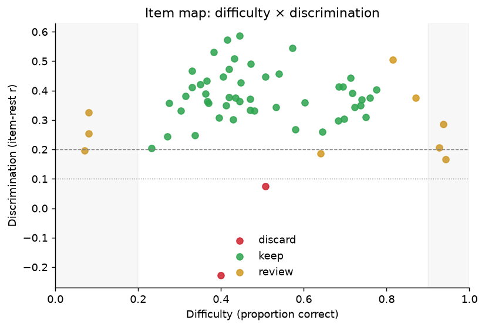
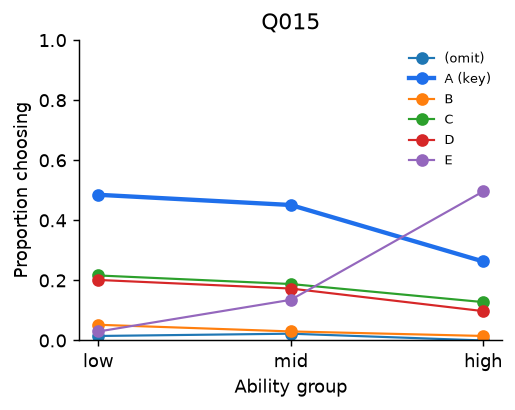
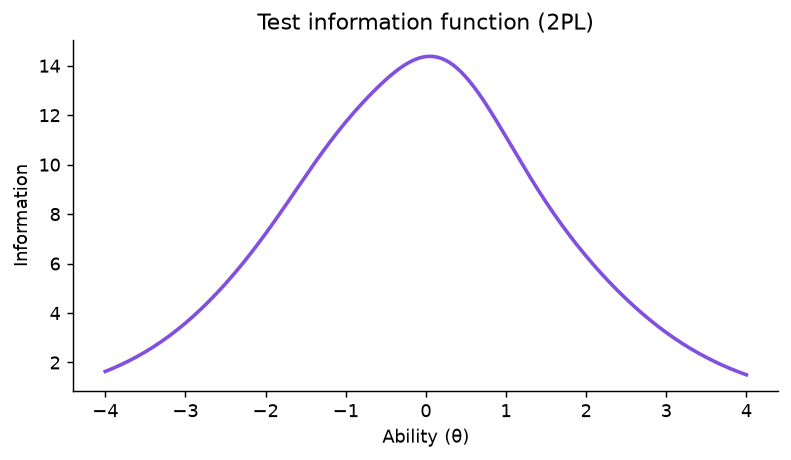

# Item Analysis & Psychometrics


> A compact, reproducible toolkit to evaluate the quality of multiple-choice items
> — from a raw response file to a decision-ready HTML report.

Item analysis answers the questions every exam committee asks after a test:
*Which items worked? Which ones were too easy, too hard, or ambiguous? Is there a
key error? How reliable is the test as a whole?* This project packages the
standard **Classical Test Theory (CTT)** indicators, a full **distractor
analysis** and **Item Response Theory (IRT)** calibration in a few hundred lines
of readable Python.

<p align="center">
  
</p>

## ✨ Features

| Module | What it computes |
|---|---|
| `itemanalysis.ctt` | Scoring, difficulty (*p*), upper–lower index (*D*, 27% rule), corrected item–rest point-biserial, Cronbach's α / KR-20, α-if-item-deleted, SEM |
| `itemanalysis.distractors` | Option proportions overall and by ability group, option–rest correlations, non-functional and "positive" distractors |
| `itemanalysis.flags` | Transparent rules that classify every item as **keep · review · discard**, with the reasons spelled out |
| `itemanalysis.irt` | Rasch (1PL) and 2PL by marginal maximum likelihood (Bock–Aitkin EM), EAP ability scores, item and test information |
| `itemanalysis.report` | Self-contained HTML report with summary cards, item map, option curves and IRT tables |

## 🚀 Quick start

```bash
git clone https://github.com/alencarpeixotofilho-cloud/item-analysis-psychometrics.git
cd item-analysis-psychometrics
pip install -e .

# 1. create a synthetic exam (400 examinees x 60 items, 5 options)
python examples/generate_sample_data.py

# 2. analyse it
python -m itemanalysis --responses examples/responses.csv --key examples/key.csv \
       --irt 2PL --out report.html --csv item_statistics.csv
```

Or from Python:

```python
import pandas as pd
from itemanalysis import ctt, distractors, flags, irt

responses = pd.read_csv("examples/responses.csv", index_col=0, dtype=str)
key = pd.read_csv("examples/key.csv", dtype=str).set_index("item")["key"]

scored = ctt.score(responses, key)
stats = ctt.item_statistics(scored)
options = distractors.option_table(responses, key, scored)
summary = distractors.distractor_flags(options)
decisions = flags.classify(stats.join(summary), summary)

model = irt.fit(scored, model="2PL")
abilities = irt.eap_scores(scored, model)
```

### Input format

| File | Layout |
|---|---|
| `responses.csv` | first column = examinee id, then one column per item with the chosen option (`A`–`E`); blank = omitted |
| `key.csv` | two columns: `item`, `key` |

## 📊 Example output

Running the pipeline on the bundled synthetic exam (α = 0.91, mean score 50.9%):

| Item | p | r (item–rest) | Decision | Why |
|---|---:|---:|---|---|
| Q015 | 0.40 | **−0.23** | 🔴 discard | negative discrimination → **key error** (planted on purpose) |
| Q009 | 0.51 | 0.08 | 🔴 discard | item barely separates strong and weak examinees |
| Q003 | 0.94 | 0.17 | 🟡 review | very easy, few functional distractors |
| Q006 | 0.07 | 0.20 | 🟡 review | very hard, low discrimination |

The option curves make the key error obvious — high-ability examinees converge on
a different option than the published key:

<p align="center">
  
  
</p>

A full sample report is available at [`docs/sample_report.html`](docs/sample_report.html)
(download and open in a browser).

## 🧮 Methods in brief

* **Difficulty** — proportion of examinees answering correctly.
* **Discrimination** — corrected point-biserial between the item and the total
  score *without* the item; plus Kelley's upper–lower 27% index.
* **Reliability** — Cronbach's α (KR-20 for dichotomous items) and the
  standard error of measurement `SEM = SD·√(1−α)`.
* **Decision rules** (configurable in `flags.Thresholds`): discard if r < 0.10 or
  negative; review if r < 0.20, p < 0.20, p > 0.90, a distractor attracts
  high scorers, or fewer than two distractors are chosen by ≥ 5% of examinees.
* **IRT** — 2PL `P(θ) = 1 / (1 + e^{−a(θ−b)})` estimated by marginal ML with a
  41-point quadrature over N(0,1); Newton–Raphson M-step in slope–intercept
  form. The test suite checks that generating parameters are recovered
  (r > 0.9 for *b*).

## 🗂️ Repository structure

```text
item-analysis-psychometrics/
├── itemanalysis/          # the package
│   ├── ctt.py             # classical indicators
│   ├── distractors.py     # option analysis
│   ├── flags.py           # keep / review / discard rules
│   ├── irt.py             # 1PL / 2PL, EAP, information
│   ├── report.py          # HTML report + figures
│   └── cli.py             # command-line entry point
├── examples/              # synthetic data generator and sample files
├── docs/                  # figures and a sample report
├── tests/                 # pytest suite (parameter recovery, flags, invariants)
└── .github/workflows/     # CI
```

## 🔒 Data & privacy

This repository contains **no real data** about students, faculty or institutions.
All examples are produced by [`examples/generate_sample_data.py`](examples/generate_sample_data.py),
which simulates responses from a 2PL model with fictitious examinee ids
(`S0001`, …) and deliberately planted item flaws.

## 🛣️ Roadmap

- [x] CTT indicators and reliability
- [x] Distractor analysis
- [x] Rule-based item classification
- [x] Rasch and 2PL calibration, EAP scoring
- [x] Self-contained HTML report
- [ ] 3PL with a prior on the guessing parameter
- [ ] Differential item functioning (Mantel–Haenszel)
- [ ] Test equating across administrations

## 📚 References

* Haladyna, T. M., & Rodriguez, M. C. (2013). *Developing and Validating Test Items.* Routledge.
* Ebel, R. L., & Frisbie, D. A. (1991). *Essentials of Educational Measurement.* Prentice Hall.
* Bock, R. D., & Aitkin, M. (1981). Marginal maximum likelihood estimation of item parameters: Application of an EM algorithm. *Psychometrika, 46*, 443–459.
* de Ayala, R. J. (2009). *The Theory and Practice of Item Response Theory.* Guilford.

## 📄 License

Released under the MIT License. See [`LICENSE`](LICENSE).
